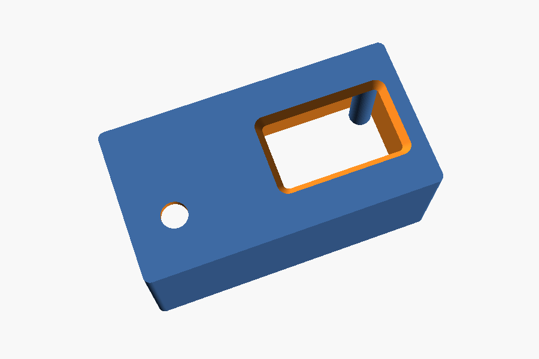
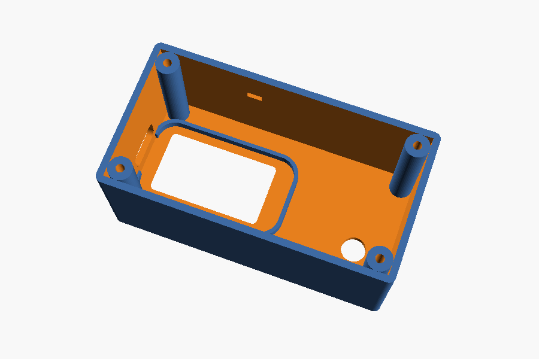
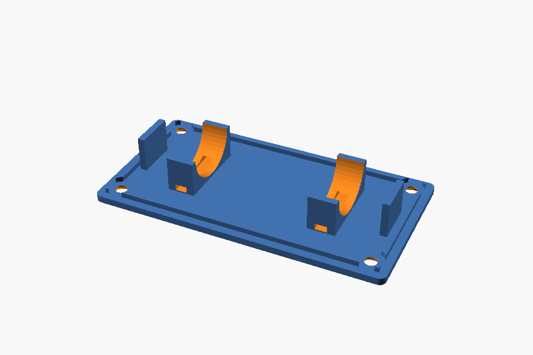

# Panel case

A 3D-printable case for the remote control panel: the Waveshare
ESP32-C6-Touch-LCD-1.47, a KY-040 rotary encoder and one 18650 cell.
`panel_case.scad` is parametric OpenSCAD. Every size is a named parameter at
the top of the file.

**Outside size: about 85 × 45 × 38 mm** (W × H × D).

Ready-to-print STLs from the default parameters are in [`stl/`](stl/):
`panel_case_body.stl` and `panel_case_lid.stl`. Regenerate them if you change
any parameter.

| Front | Inside the body | Lid with cell cradle |
|---|---|---|
|  |  |  |

```
 front                                       back (lid removed)
 +-----------------------------------+      +-----------------------------------+
 |   ___     +--------------------+  |      |  o                             o  |
 |  /   \    |                    |  |      |  ===============================  |
 | | (o) |   |   screen window    |  |      |  [  18650 cell in the cradle   ]  |
 |  \___/    |                    |  |      |  ===============================  |
 |   knob    +--------------------+  |      |  o                             o  |
 +-----------------------------------+      +-----------------------------------+
  USB-C on the right wall, slide switch in the bottom wall
```

## Parts

| Part | Notes |
|---|---|
| `body` | Front plate with the screen window and knob hole, walls with the USB-C and switch cut-outs, 4 corner posts |
| `lid` | Back plate with a locating lip and a 2-saddle cradle for the cell |
| 1 × 18650 cell | **Protected**, ~3000 mAh, rated for **2 A charging**: see "Battery" |
| 1 × KY-040 encoder + knob | 6 mm D-shaft knob, ≤ 20 mm across |
| 1 × SS12D00 mini slide switch | Optional, cuts the battery |
| 4 × M3 × 8 mm screws | Countersunk, self-tapping into the posts |
| 2 × zip ties (≤ 3.5 mm wide) | Hold the cell in the cradle |
| Wire, heat-shrink, hot glue or 1 mm foam tape | |

## Before printing: check these against your parts

The design follows Waveshare's dimension drawing for the board. The encoder
numbers are typical KY-040 values, but **KY-040 modules vary**. Measure yours and
edit the parameters:

| Parameter | Default | What to measure |
|---|---|---|
| `usb_side` | `"right"` | Confirmed on this board: with the UI upright, the USB-C port is on the right. Only change it for a different board or screen rotation |
| `ky_l`, `ky_w` | 32, 19 | The KY-040 PCB size |
| `ky_shaft_from_top` | 12.5 | From the PCB edge opposite the pins to the shaft centre |
| `ky_bush_d` | 7.0 | The threaded bushing's diameter (M7 on EC11 encoders) |
| `batt_len` | 70 | Your cell's length. Protected cells are 67–70 mm, bare ones about 65 |
| `usb_z` | 8.2 | From the screen glass to the USB-C port's centre |

## Printing

- **Body:** print it **front face down**. The window's 45° chamfer and the
  knob hole need no supports. The USB-C and switch openings are small enough
  to bridge.
- **Lid:** print it plate down. The saddles and end stops print upright.
- PETG or ASA is the safer choice next to a battery. PLA works but softens in a
  hot car.
- 0.2 mm layers, 3 walls, 20 % infill.

Export STLs (on macOS the binary is
`/Applications/OpenSCAD.app/Contents/MacOS/OpenSCAD`):

```bash
openscad -D 'part="body"' -o panel_case_body.stl panel_case.scad
```

```bash
openscad -D 'part="lid"' -o panel_case_lid.stl panel_case.scad
```

`part="assembled"` shows everything in place, with see-through stand-ins for
the board, encoder and cell. Use it to check the fit before printing.

## Assembly

1. **Encoder:** remove its nut and washer, push the bushing through the
   knob hole from inside, then tighten the nut from the front and fit the
   knob. Wire it first, following [`docs/WIRING_ROTARY_ENCODER.md`](../../docs/WIRING_ROTARY_ENCODER.md).
   The header pins point down. Either bend them towards the back or solder
   wires to them directly: there are about 7 mm below the PCB.
2. **Display module:** press it, screen first, into the rim behind the window
   with its USB-C port facing the USB-C opening. A few dots of hot glue on the
   rim, or 1 mm foam tape between rim and board, keep it from rattling.
3. **Switch:** glue the slide switch inside the bottom wall so its lever
   sticks out through the slot.
4. **Battery:** wire it as below, then strap the cell to the lid's saddles with
   the two zip ties through the slots.
5. **Close:** seat the lid's lip in the opening and fit the 4 screws.

### Battery wiring

```
 18650 (+) ──── switch ──── VBAT  (board header, top of the right row)
 18650 (−) ──────────────── GND   (board header)
```

- Use the board's **VBAT** pin. Never connect the cell to 3V3 or VBUS
  (Waveshare's own warning). The board's charger and 3.3 V regulator take
  it from there.
- The switch only disconnects the battery. With USB plugged in, the board
  still runs and **charges the cell only while the switch is on**.
- **Polarity:** double-check before connecting. A reversed cell can destroy
  the board.

## Battery

The board's charger (ETA6098) is set by its 82 kΩ resistor to charge at
**2 A**, from 4.2 V down to a 130 mA cut-off, with **no temperature sensing**.
So:

- Use a **protected** 18650 (with a built-in protection board) that's rated to
  charge at 2 A or more: for example Samsung 30Q or 35E. Avoid cells limited
  to a 1 A charge, such as the LG MJ1.
- Don't put a small LiPo pouch in this case. Anything under ~2000 mAh would
  charge too fast at 2 A.
- From a computer's USB port, the current is limited to about 0.5–0.9 A and
  charging takes longer. A 2 A phone charger gives the full rate.

**Runtime with the current firmware: about 2.7 days** on a 3000 mAh cell. That
assumes about 40 mA on average: the ESP32-C6 stays awake with Wi-Fi and
Bluetooth on, and the screen is off most of the time. This is an estimate,
not a measurement. Firmware power saving, letting the chip sleep while the
screen is off, could roughly triple it.
